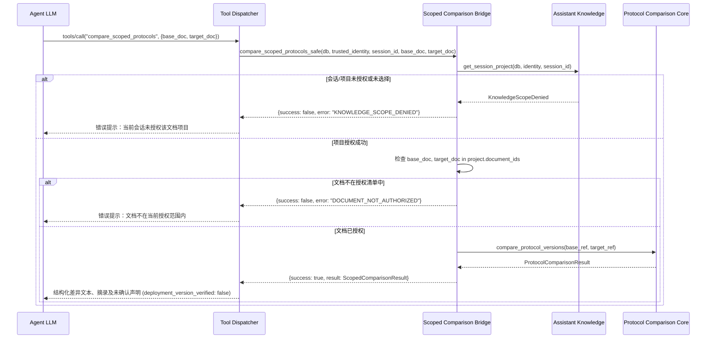

# AR-03-02 未来 Assistant 集成契约与最小注册点规范 (INTEGRATION_CONTRACT.md)

> **重要约束：** 本文档仅定义未来接入 Assistant 时的接口契约与最小注册点。**本阶段严禁在 `opspilot/assistant.py` 或 `opspilot/assistant_mcp.py` 中注册工具**，后续必须在获得主 Agent 明确集成授权后方可执行。

---

## 1. 最小工具定义与注册点

当后续阶段授权将协议比较暴露给 Assistant 模型时，应在 `opspilot/assistant_mcp.py` 中增加以下唯一的只读工具注册点：

### 工具标识符 (Tool Name)
`compare_scoped_protocols`

### 暴露给模型的 JSON Schema
```json
{
  "name": "compare_scoped_protocols",
  "description": "比较当前已授权项目中的两份协议文档版本，返回结构化正文差异、修改行号和摘录。注意：文档差异纯属规范说明，不能证明线上环境实际运行的版本。",
  "parameters": {
    "type": "object",
    "properties": {
      "base_document_id": {
        "type": "string",
        "description": "基准文档标识符（必须是当前已选择项目授权的文档 ID，如 callback-retry-contract）"
      },
      "target_document_id": {
        "type": "string",
        "description": "目标文档标识符（必须是当前已选择项目授权的文档 ID，如 callback-retry-contract-v2）"
      },
      "base_version": {
        "type": "string",
        "description": "可选：指定基准文档版本（如 1.0.0）。若文档 ID 唯一则可缺省"
      },
      "target_version": {
        "type": "string",
        "description": "可选：指定目标文档版本（如 2.0.0）。若文档 ID 唯一则可缺省"
      }
    },
    "required": ["base_document_id", "target_document_id"]
  }
}
```

---

## 2. 运行时安全注入原则（禁止模型输入的参数）

以下参数由 Agent 宿主环境在服务端从当前受信上下文中隐式注入，**绝不允许作为模型输入**：
1. `db_path / connection`：来自当前环境的可信 SQLite 数据源；
2. `identity: TrustedIdentity`：来自当前经过鉴权的可信操作者身份（`tenant_id`, `actor_id`, `role`）；
3. `session_id: str`：来自当前可信会话上下文；
4. `catalog_dirs`：受信任的服务端协议资料清单目录；
5. 磁盘绝对路径、文件名称、文件哈希或 Authorization 标头：**模型无权指定任何文件路径或伪造哈希**。

---

## 3. 调用流程与异常处理映射



---

## 4. 交付给模型的观察结果与认知约束

1. **结构化差异：** 仅包含受权限保护的章节变动、词法线索提示（advisory hints）和滑动窗口证据摘录。
2. **认知警示注入：** 模型必须将比较结果视作离线文档证据，并在向用户解答时主动说明：“文档规范显示 v2 增加了 `attempt_count` 参数，但这无法证明线上集群当前已生效该版本，需结合运行时链路状态核实。”
3. **不可伪造凭证：** 本工具输出不得作为任何写操作（ActionIntent）、审批（Approval）或任务绑定（TaskBinding）的输入证据。
