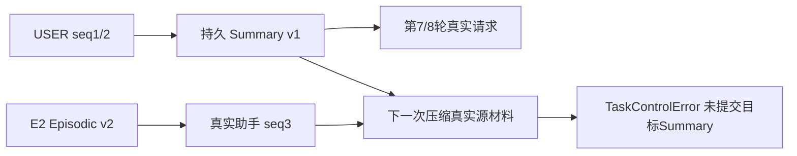

# 真实 Summary 来源实验：PARTIAL

结论：**没有形成任务卡要求的持久 Episodic→Assistant→Summary→后续实际请求完整目标 DAG**。原实验及唯一一次修复后对照均已按冻结上限停止。以下分开说明已证明与未证明的边，不把“Chat 成功”算“摘要实验成功”。

## 原 B：有真实 Summary，但不是目标依赖

- 冻结 `f747d9e3abf3e6bceb112293af29ccdaf2d8f541`，固定输入 B_INPUTS.json，HYBRID 输入3600、输出预留512、余量1024、窗口16384、SDK retry0、每Run至多3次、8 ACTIVE +2撤销/重启轮次。
- 来源 Task `task-c139d0d1-9e07-4055-9b95-10316384903a` 经新独立审批完成真实 v9→v10、HTTP200/报告/交付；E2 `episodic-6b1aaa89-3267-49f0-85f9-b2f2420a31fb` v2，digest `1ac68e744d2f329a4c013791b64880edde8a2bab7e17206eea6691e4a2669a53`。
- 目标 Task `task-b1f6c544-8733-42ad-b88e-d69d58a151b9`，Session `session-c3380e79-8b86-46a0-8f95-99ae2629297c`，当前真实 v11/401。当前事故由显式 fixture 单独准备，不计 Agent 恢复。
- 第1轮真实 Chat `run-6805712c-8fc7-4bed-b70e-50401af6962b` → 助手 `message-98877bea-4180-4dee-885d-f1d487a06889`，真实模型区分来源 v9→v10/200 和当前 v11/401；持久来源含 E2 v2。

第7轮真实压缩 Attempt `context-compression-cbe5e5d2-860e-401c-aed3-234035ce0295` 成功，Response `57b6ecd2-11b5-4c47-b20c-fe8b9fbaff58`，429/1237/1666 Token。Summary `context-summary-03c91570-9673-492f-b0a9-791c6fdc8374` v1，digest `76b9d0f7d49af74051e0f8f301d698baae155eeeb77bd275219489fb3789f5c2`，覆盖seq1–2 **两个用户消息**。真实 Summary 保存最初目标、只读/禁止代签、历史不能作为当前、待审批等条件；没有把本任务标为已恢复。第7/8轮实际请求确实选用它。

该 Summary 的依赖只有 TaskState + 两个 USER MESSAGE，**没有目标助手或 Memory**。撤销 E2 后它仍有效属于正确行为，不能说它“经历了 Memory 撤销失效”。

第8轮 Attempt `context-compression-2345279c-8da9-40a3-a32d-eda9bc4a1145` 的**实际 HTTP 请求**源材料精确包含 seq3 目标助手、seq4 用户消息、父 Summary1、E2 v2及4项当前Evidence依赖。真实 Provider 返回HTTP200，但提交失败，Summary ID/Response ID/Usage 均为空。

当前 Probe 17:39:28 获取，300秒边界17:44:28；压缩17:44:16.118登记，17:44:30.254失败。源码提交前重新计算有效 Context，旧助手失效后原压缩可能不再需要。已捕获的异常类只有 TaskControlError，具体错误码并未保存；时间与路径支持 TTL 导致重新计算变化，**不冒充捕获了精确异常文本**。

随后有效来源重建，第8轮回答成功；没有直接插表或延长TTL。E2在17:45:59撤销，第9/10轮（含同库重启）无旧Memory/助手，原用户来源Summary仍有效。但排除已受TTL影响，撤销因果未隔离。

## C审计发现两跳来源 P1

固定输入/策略之外的源码审计发现：Memory块被裁剪时，派生助手只保存 MODEL_ATTEMPT 父引用，原验证未递归检查祖先助手。独立冻结 `4ea16579c3e6d9b39ea6ecf14d41e5f2168abba6`，RED02 两类资产均失败，测试提交 `ba44a5c36ab37ab000096e042e23c6b7f022b6b0`。

生产修复 `00d054aeba196b972255dafd0e7faa03fcd0ce41` 仅在原函数加35行来源递归、scope与环保护；26项定向及227项全量通过。测试使用明确标注的确定性 Provider，不能代替真实 Summary DAG。

## 唯一一次修复后真实对照

准确身份与输入先于聊天提交：`73fc3a9fdd9d3edc4d082a3725641b3f4ab2421f`。保留原B不改；没有第三次实验。

- 来源是前一目标 Task D，经新的独立 APPROVER 批准后真实修复 v11→v12、同身份200/报告/交付。
- E3 `episodic-bf9f8893-5c13-4879-9a35-7ba0bda732c0` v2，digest `cc5ec7bc52e9d6e2591ffa82aec14770dfbc30309fe44102cf5bb2541299588d`。
- 新目标 Task `task-0d3394ba-3b79-4a5a-8412-a3a4db3989c7`，Session `session-698a7270-45ad-4e35-a2cd-c3ae7de6bba9`，准备 Investigator Run `run-ef3a2423-572e-4cc5-a37e-ff086a68878a`，真实 v13/401、5 Provider/4 MCP。准备沿用12000默认，Chat切回同一冻结3600。
- 8个ACTIVE与第9/10轮均经正常认证Web API提交，真实浏览器展示同一Session持久内容。不是十次人工点击。固定输入文件SHA256 `d13d180ff9b586bc6c07c53651a8c23fac768fdffd2c104d8efa07e00642d40a`。

前6轮真实请求包含E3正确版本，助手区分历史200与当前401，未改变Plan/审批/业务。第7轮触发真实压缩 `context-compression-4ce7f654-c0d4-4904-b4dd-4352182252b0`，源材料仍是前两个用户消息，尚未包含目标助手。

**实验执行延迟是限制的一部分**：当前 Probe 于18:06:58取得；身份冻结、控制器重启和测试脚本准备使第1轮到18:11:08才发出，距300秒TTL仅约50秒。第7轮压缩18:11:57.209开始，18:12:04.388抛TaskControlError，彼时Probe已过期；实际HTTP200存在，但无Summary/Usage持久化。不能把这归咎于预算太低或仅Provider慢而省略准备耗时。

第7/8轮重新构建后没有当前事实/Memory块、旧6个助手按EVIDENCE_EXPIRED_OR_OUT_OF_SCOPE排除，Context无需原压缩。8轮结束 **0持久Summary**。18:12:18.541 E3撤销为v3，第9轮实际请求仍无旧Memory/助手。API于18:12:21.831杀进程、18:12:23.920同库启动，第10轮再次无旧来源。由于失效先于撤销，不能把这当“撤销单独导致派生摘要消失”的成功实验。

后8轮 Chat（包括撤销和重启）成功不代表目标Summary成功。`P1-summary-before-revocation.json`为空摘要表，`P1-long-chat.log`和所有Attempt保留。没有延长TTL、改固定输入、提高预算/次数、直接插Summary或运行第三次。

## 最终证明矩阵

| 边/行为 | 原B | 修复后对照 |
|---|---|---|
| ACTIVE跨Task真实Memory→实际Provider→助手 | 已证明 | 已证明 |
| 真实模型压缩请求 | 2次 | 1次 |
| 持久Summary | 1份，用户来源 | 0份 |
| 目标助手/Memory进入压缩源材料 | 已证明，提交失败 | 未达到 |
| 目标Memory依赖Summary被后续请求选用 | **未证明** | **未证明** |
| 撤销后/重启后实际请求无旧资产和旧助手 | 已观察，TTL混杂 | 已观察，TTL混杂 |
| 撤销使目标Summary递归失效的真实因果 | **未证明** | **未证明** |
| 两跳Episodic/Semantic撤销程序回归 | 原代码RED | 新代码GREEN（确定性测试） |

本实验结论PARTIAL，按任务卡作为学习补证单独交回，不追溯改写旧Gold或旧CLOSEOUT状态。
