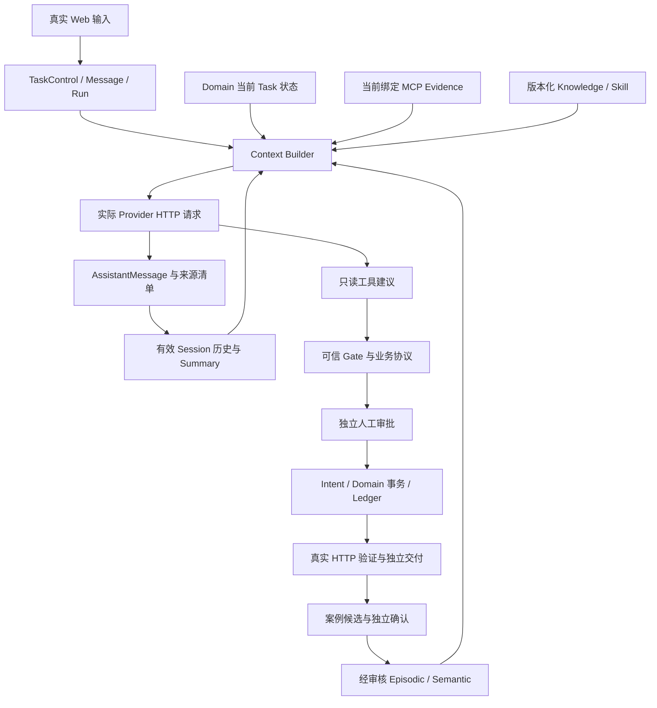

# OpsPilot M3 Context / Memory 阅读入口

本材料对应 M3-HF-02，代码起点 `c2f71e9b4e3db9fdc3cd522115f304e6a53dfaae`，本轮唯一生产修复 `00d054aeba196b972255dafd0e7faa03fcd0ce41`。它解释已有系统，不提出新平台。最终运行状态以 [本轮报告](../../evidence/vnext/m3-hf-02/REPORT.md) 和机器结果为准；阶段验收仍由主 Agent 决定。

## 1. 用户实际获得什么

用户在同一 Session/Task 继续提问时，Agent 能区分用户观察、当前 MCP 事实、历史成功案例、尚未批准的计划和已经提交的业务回执。历史经验可以提示“下一步查什么”，不能把别的任务修好过的 HTTP 200 说成本任务已经恢复。用户撤销经验后，后续回答和恢复执行必须重新构建 Context，不能继续使用它的派生回答。

普通 Chat 只解释；正式关键纠错创建新的调查 Run，并在 Domain 更新控制版本。支持人员、审批者、执行身份及 TaskBinding 不由模型决定。S1 恢复依赖真实 REPAIR、同身份 HTTP 200、订单字段及独立 DELIVER；S2 接收回执表示受控交接，不表示 Scope 已授予或接口已恢复。

## 2. 分层存储，而非一种“记忆”包办所有状态

| 概念 | 本项目中的实际载体 | 有效性/权限 | 不承担的职责 |
|---|---|---|---|
| Working | Investigator Run 的输入锚点、当前工具观察引用、假设/下一步及有限预算 | TaskControl、绑定资源、当前证据、模型/MCP 预算 | 不自行批准、不存任意长期知识 |
| Session | `messages`、`chat_run_answers`、ContextManifest、Summary 及依赖表 | tenant/session/task、消息 digest、来源实时校验 | 历史文字不是当前事实 |
| Episodic | 从真实案例回执构建的候选经验，沿用 D5 Domain | CANDIDATE→独立 APPROVER ACTIVE→REVOKED/过期，版本/digest/来源可查 | 不能继承源任务授权或充当目标 Evidence |
| Semantic | 现有项目范围内、受审版本化方法/别名经验 | 当前 scope、版本、digest、审核、撤销和来源检查 | 不是事实数据库或自动权限配置 |
| Procedural | 此处只是概念分类：映射已有版本化 Skill 中的方法步骤 | Skill 文件完整性、适用问题、版本/digest | **没有新增 Procedural Memory 表、类型或服务** |
| Knowledge | 现有版本化领域文档和引用 | 文档版本/摘要及适用性，冲突让位当前权威事实 | 不是 AuthPolicy、Grant 或实时 Authz Decision |
| Skill | `skill_assets.load_applicable_skill()` 加载的有限方法提示 | 白名单资产、完整性与问题适配 | 不定义审批或业务状态转换 |
| Checkpoint | LangGraph SQLite 持久执行进度、interrupt、引用 | 所有者/TaskControl/当前 Domain 一致性 | **不证明外部副作用已发生** |
| Domain | SQLite TaskControl、Plan、Approval、Intent、Ledger、验证/报告/交付/交接回执 | 可信事务与权限守卫 | 不把模型文字提升为授权 |



模型侧箭头表示建议或输入，绝不表示赋权。图中没有向量库、Redis、第二套 Runtime 或新的业务写入口。

## 3. Chat 的 Context 怎么装配

`domain/chat.py::_prepare_context()` 读取可信状态、当前版本兼容 Evidence、适用资产及最多已有历史窗口。`context_engineering.allocate_context_blocks()` 先计算必须块；必须块超预算就 fail closed。可选块按优先级挑选，再按原顺序排列：Summary 优先级 2000，历史消息 1000+index，Memory 20。低预算下 Memory 可以被裁掉，但已选历史助手的来源仍必须有效。

这正是本轮 P1 的触发条件：第二条回答没有直接 Memory 块，却读过第一条依赖 Memory 的回答。修复后检查 MODEL_ATTEMPT 时递归检查对应历史助手的来源；不能只因为 Provider 调用完成就认为历史内容永远可用。

输入预算是应用本地 `tiktoken:cl100k_base` 估算，不是 DeepSeek 的账单或硬模型窗口。默认配置 12000 输入、512 输出预留、1024 余量、16384 应用窗口。本轮 Chat 摘要实验预先固定 3600 输入，SDK retry=0，每 Run 压缩+回答最多 3 次。历史 Token 不够时允许排除可选块；不能删除可信控制块来强行回答。

## 4. 一条可审计的派生链

```text
可信源 Task 的 REPAIR/验证/报告
  → Episodic ID@version+digest，独立确认
  → 模型请求实际选用该资产
  → AssistantMessage + chat_message_sources
  → Summary + context_summary_dependencies
  → 后续 Provider 请求实际选用该 Summary
```

每条箭头需要自己的证据。存了 Summary 不等于形成了 Memory 依赖；压缩源里有 Memory 不等于 Summary 已提交；Manifest 选择不等于网络发出；HTTP 200 响应头也不等于取得了最终模型文本和 Usage。

撤销后，新 Context 重新读取资产状态，检查消息和摘要的传递依赖，并按现有策略选择其他有效来源或安全停止。重启不是豁免：Checkpoint 不保存可直接重注入的已撤销经验正文。

## 5. 四种证明状态

| 级别 | 含义 | 本轮例子 |
|---|---|---|
| 已实现 | 源码存在且边界可解释 | 资产状态机、Summary DAG、MODEL_ATTEMPT 祖先来源递归 |
| 自动化验证 | 确定性单元/集成测试；可能使用明确标注的测试 Provider | 227/227 全量、26/26 定向，含两类经验的 RED→GREEN |
| 真实端到端验证 | 新鲜 Web/HTTP、真实 Provider/MCP、Domain 与恢复证据相互匹配 | A 的新鲜案例、撤销、新 Chat/Investigator 和同 Run 跨进程恢复 |
| 尚未证明 | 不能由前三种推导 | 历史 Worker 两次失败的实际根因、未知请求费用、Memory 普遍增益、生产级 IAM |

B 的真实目标 Summary DAG 是否形成，需要看本轮 `SUMMARY_LINEAGE.md`，不能从单元测试外推。此前 CLOSEOUT 的 PARTIAL 和 D6 E10 PARTIAL 保留原样。

## 6. 本地 Demo 边界

这是单实例 Worker + 本地 SQLite + 本地可信角色的演示。没有远程企业 IAM、分布式事务、生产多项目授权承诺。HTTP 事务之外的模型调用可能在崩溃后已被 Provider 执行而本地未知；只能保留身份、预算和 UNKNOWN，不能保证外部模型 exactly-once。业务写入则凭 Domain 的 Intent/Ledger、CAS 与业务唯一性守卫恢复。
