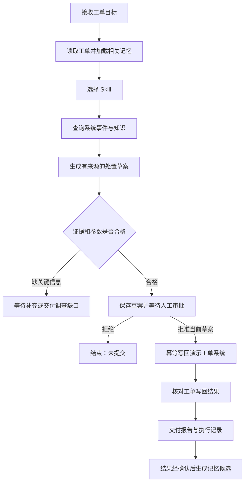

# 新 Agent 项目：一周交付主线

更新时间：2026-10-16（北京时间）。当前阶段：方案与任务拆分，尚未实现业务代码。

## 1. 这次要交付什么

推荐场景：**企业技术支持与工单处理 Agent**。这是本轮设计采用的场景建议；用户已确定 LangChain + LangGraph、外部能力建设和一周冲刺方向，业务场景仍可在 Day 1 开始时调整。

一句话目标：接收一张服务故障工单，结合知识、系统事件和历史经验形成带证据的处置建议，经人工批准后写回演示工单系统，并在结果得到确认后沉淀经验。

本周完成的是可复现、可演示、可解释的求职项目 MVP。完成工单建议的调查与写回，不等于自动修复了生产故障。

现有项目的 README 和学习笔记表明，旧项目已经围绕证据检索、自建运行时、受限工具执行和验证做了较多工作。本项目突出框架应用、外部系统接入、跨任务记忆和可恢复业务流程；两者可以共同证明底层理解与应用交付能力。此处是文档对照，未重新审计旧项目代码与测试。

| 简历材料 | 主要证明什么 |
|---|---|
| Java 工作经历 | 后端开发和已有工程经历 |
| 旧 Agent 项目 | 自建执行循环、证据链、工具边界、评测与取舍 |
| 新 Agent 项目 | LangGraph 编排、MCP 集成、可复用 Skills、持久记忆、审批恢复及任务交付 |

## 2. 唯一业务主线

演示输入：`请调查工单 T-1001：订单服务在发布后出现大量超时，给出处置建议，批准后写回工单。`

固定的是业务阶段和执行边界。模型在调查阶段根据工单选择相关 Skill、所需查询、参数和后续补证；信息不足时必须保留不确定性。这样既有 Agent 的动态决策，也能明确验收。

一周内只做两类问题：发布后异常、配置不一致。每类问题各一个 Skill，共用同一条主链。

## 3. 技术与责任边界

采用 Python + LangChain + LangGraph + SQLite。首版通过命令行完成演示；FastAPI 接口可在主链稳定后作为选做。具体依赖版本在 Day 1 安装验证后锁定，不从旧教程照搬 API。

| 部件 | 本项目的责任与最小实现 | 验收证据 |
|---|---|---|
| LangGraph | 一张 StateGraph 管业务阶段、条件分支、持久检查点和审批中断；不另造循环框架 | 相同任务暂停、进程重启后恢复 |
| LangChain | 模型适配、工具 Schema、结构化结果，以及图内有限的模型—工具交互 | 一次真实模型工具调用与结构化草案 |
| Function calling | 模型表达工具名和参数；应用校验并执行 | Schema 校验、工具名和参数的执行记录 |
| MCP | 一个独立本地演示服务，暴露工单查询、事件查询和工单备注写入 | 真实协议连接、发现与调用记录 |
| Knowledge | 约 10 篇自建运行手册，保留文档 ID 和版本；先做简单检索 | 草案中的来源能定位到原文 |
| Memory | 独立 SQLite 表，跨任务保存经确认的经验；按项目/用户作用域过滤，再按问题标签检索 | 新任务命中历史经验；另一作用域不可见 |
| Skills | 两个仓库内能力包：说明、适用条件、步骤、输出模板、验证样例 | 先选元信息，再加载选中包正文；可追踪版本 |
| 上下文 | 当前目标、结构化状态、相关知识/记忆和选中 Skill；大日志保存在任务文件中 | 输入来源清单、截取规则和原始结果引用 |
| 观测与评测 | 本地 JSONL 事件和固定回归样例 | 可查询节点、工具结果、耗时、模型用量与失败原因 |

Function calling 是模型提出调用的方式，MCP 是连接能力服务的协议，Skill 是组合动作完成某类任务的方法。它们在同一执行链里配合，无须各做一套独立框架。

SQLite 检查点负责当前任务恢复；长期记忆使用独立的业务表和读写函数。本方案不假定任意内存 Store 都能持久保存，也不把聊天记录直接当成长期记忆。首版按作用域和标签检索即可，语义向量检索列入后续。

## 4. 最小契约

### 输入、状态和输出

- 输入：工单 ID、用户目标。项目/用户作用域由可信的本地启动配置绑定，不能由模型工具参数随意覆盖。
- 状态：`task_id`、`ticket_id`、作用域、阶段、选中 Skill 及版本、证据引用、草案、审批状态、提交结果、错误及预算。
- LangGraph 的执行 `thread_id` 对应本项目任务实例；用户界面的会话 ID 若以后加入，单独存储关联。
- 输出：问题摘要、证据、处置建议、尚未确认事项、是否获批、工单写回结果、报告位置。
- 终态区分：建议已写回、审批被拒、缺信息、执行失败。写回成功不能标成服务已恢复。

### 工具

| 工具 | 接入方式 | 行为 |
|---|---|---|
| `get_ticket` | MCP | 读取演示工单和当前备注 |
| `query_service_events` | MCP | 按服务和时间范围查询演示事件 |
| `append_ticket_note` | MCP | 将已批准草案写入演示工单，返回稳定结果 ID |
| `search_runbook` | 本地 LangChain 工具 | 检索少量运行手册并返回带来源的片段 |

演示数据可以是自建 fixture，但 MCP 协议、工具执行、持久化和工单状态变化必须真实运行。演示中明确说明业务数据是模拟数据，不把它描述成真实企业系统接入。

### 审批、恢复和经验沉淀

1. 等待审批前，保存完整草案。审批绑定草案内容摘要和目标工单；修改草案后重新审批。
2. 中断节点内不执行工单写入；恢复时重新核对审批对象，之后进入独立提交节点。
3. 写入使用稳定幂等键；演示服务在同一事务内记录键与写回结果。响应丢失或恢复后先核对结果，避免重复备注。
4. 检查点提供恢复位置，不单独保证外部写入恰好一次。
5. 经验候选只有在用户明确确认处理结论或有可核验结果时才可转为有效记忆。仅仅生成建议、获得提交批准或成功写回都不够。
6. 记忆保存来源任务、适用服务/版本、确认时间、作用域、有效状态；支持纠正和删除。旧经验与新工具事实冲突时，以当前证据重新判断。

默认调查预算：最多 6 次工具调用；只读查询至多重试 1 次。耗尽预算就交付缺口，不能无限循环。工单写入的重试必须经过幂等核验。

## 5. 按全书取舍，而非按目录堆功能

以下是结合全书目录与重点章节形成的本项目取舍，不是白皮书要求所有项目都实现的功能清单。重点核对了第 5、6 章的能力边界及第 21 章的评测思路；其余先依据章节导航建立覆盖关系，实施时按需阅读。

| 白皮书章节 | 本周怎么使用 | 本周范围 |
|---|---|---|
| 1–2 架构 | 明确业务目标、系统边界和交付物 | 一张业务图 |
| 3 构建方式 | 选择框架提供的编排能力 | LangChain + LangGraph |
| 4 任务 | 阶段、补证、等待与结束 | 一张图，无多 Agent |
| 5 信息 | 区分状态、知识、记忆和 Skill | 按需加载与证据引用 |
| 6 行动 | 结构化调用、MCP、审批和结果核验 | 三个 MCP 工具 |
| 7 运行环境 | 给演示进程明确工作目录和资源范围 | 本机受限业务工具；不建通用沙箱 |
| 8 状态存储 | 任务恢复与跨任务经验持久化 | SQLite + 本地报告 |
| 9 流量治理 | 限制调用量并记录用量 | 不建独立 AI 网关 |
| 10 异步任务 | 展示等待审批后恢复 | 不建后台任务队列和调度平台 |
| 11–12 协作通信 | 知道何时需要更复杂协作 | 多 Agent、A2A、分布式全部后置 |
| 13 观测 | 按任务关联节点、调用和结果 | JSONL 即可 |
| 14 安全 | 执行前检查工具、参数、作用域和审批 | 加入异常与越界验收 |
| 15 资产 | 给手册、Skill、Prompt 留版本 | 仓库文件管理，无注册中心 |
| 16 行为验证 | 用可复现演示环境验证分支 | 成功和失败案例一起验收 |
| 17 模型调优 | 判断问题来源 | 本周不训练、不微调 |
| 18–20 调优与轨迹 | 保留逐例结果并定位失败阶段 | 本地结果文件，无数据平台 |
| 21–22 数据与 Badcase | 建立固定题集，修复后回归 | 12 个场景，改善至少一个具体失败 |
| 23 经验演进 | 验证经验候选后复用 | 人工确认，不自动修改自身规则 |
| 24 边缘优化 | 作为后续背景阅读 | 不实现 |
| 25–29 与 Jev 专题 | 参考企业 IT 等业务流程的设计方法 | 借鉴场景，不复制各案例系统 |
| 30 展望 | 理解长期方向 | 不加入本周功能 |

## 6. 一周验收与简历证据

以下全是计划目标，目前没有已测结果。

- 能从新环境按启动说明完成一条真实模型 + 真实 MCP 调用的主链演示。
- 有两个不同问题类别的演示，至少一次显示 Skill 选择带来的方法差异。
- 审批前无备注写入；拒绝后无写入；变更草案后旧批准失效。
- 重启后能继续待审批任务；同一提交重复恢复不产生重复备注。
- 新任务可复用已确认记忆；换作用域查不到该记忆；删除后不能再检索到。
- 每个关键结论能追到手册或系统事件；证据不足不会捏造修复成功。
- 固定 12 个场景保存逐例结果；目标是全部跑完，任务成功率如实报告。审批、作用域和幂等断言必须全部通过。
- 记录模型、依赖和 Prompt/Skill 版本、总耗时、调用次数、可获得的 token 用量；取不到的指标标注不可用。
- 至少留下一组相同场景、相同环境下的修改前后结果；无收益也如实记录。
- 交付启动文档、3–5 分钟演示、实际测量报告、3 条可核查的简历素材。

12 个场景建议：发布后异常、配置不一致、缺服务信息、证据不足、审批拒绝、批准后草案改变、等待中重启、重复提交、跨作用域记忆、过期经验冲突、工具结果夹带越权指令、工具超时。固定回归集不冒充独立泛化测试；可选再留 4 条未参与调试的变体。

## 7. 控制范围

本周保持：一个业务场景、两类问题、一张图、一个 MCP 服务、两份 Skill、一个持久化方案。

后置：多 Agent、A2A、微服务、通用插件市场、独立网关、复杂前端、向量数据库集群、自动代码修复、生产发布、自进化、模型微调。

新需求必须写清它解决哪条主线的哪个验收缺口，以及替换掉哪项原任务。无法说明的进入后续清单；不通过增加当日工时来隐式扩张范围。常规实现选择直接推进，不设置层层审批。

每完成一天，必须能演示当天新增行为，再接下一层能力。Day 2 主链未跑通就缩小样例范围；Day 4 仍被环境问题拖住时取消可选 API/界面和语义检索，保留核心接入与验收。

## 8. 参考与项目入口

- [七天任务与今日进度](TASKS.md)
- [全书目录与阅读路线](https://github.com/aliyun/ai-agent-handbook#3-阅读导引)
- [第 5 章：上下文、状态与可复用能力资产](https://github.com/aliyun/ai-agent-handbook/blob/main/02-build/第%205%20章%20信息：上下文、状态与可复用能力资产.md)
- [第 6 章：受控执行与交付准备](https://github.com/aliyun/ai-agent-handbook/blob/main/02-build/第%206%20章%20行动：受控执行、验证反馈与交付准备.md)
- [第 21 章：黄金数据集](https://github.com/aliyun/ai-agent-handbook/blob/main/05-optimization/第%2021%20章　Agent%20黄金数据集.md)
- [LangGraph 概览](https://docs.langchain.com/oss/python/langgraph/overview)
- [LangGraph 持久化](https://docs.langchain.com/oss/python/langgraph/persistence)
- [LangGraph 中断恢复](https://docs.langchain.com/oss/python/langgraph/interrupts)
- [LangGraph 记忆](https://docs.langchain.com/oss/python/langgraph/add-memory)
- [LangChain MCP](https://docs.langchain.com/oss/python/langchain/mcp)

框架资料核对日：2026-10-16。实际编码时以锁定依赖版本的接口与验证结果为准。
